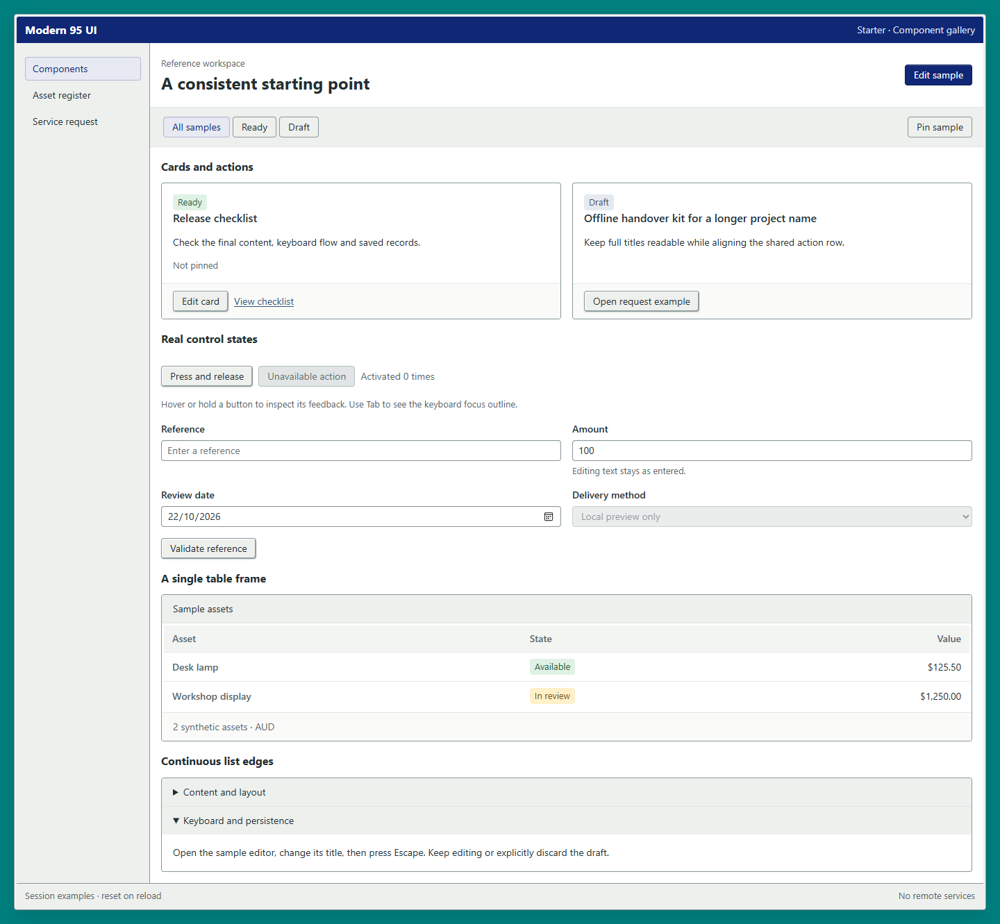
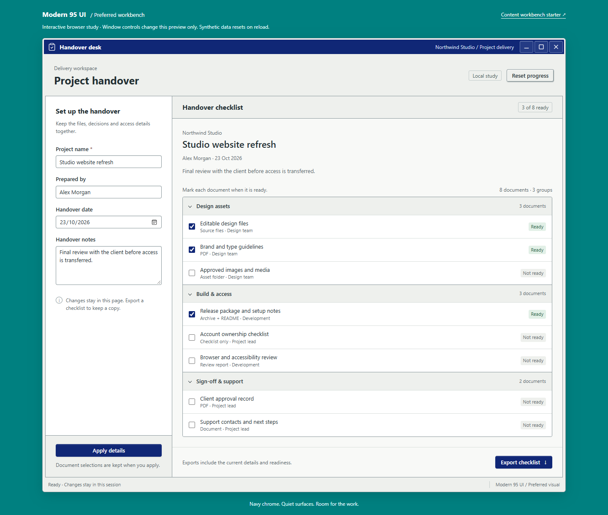
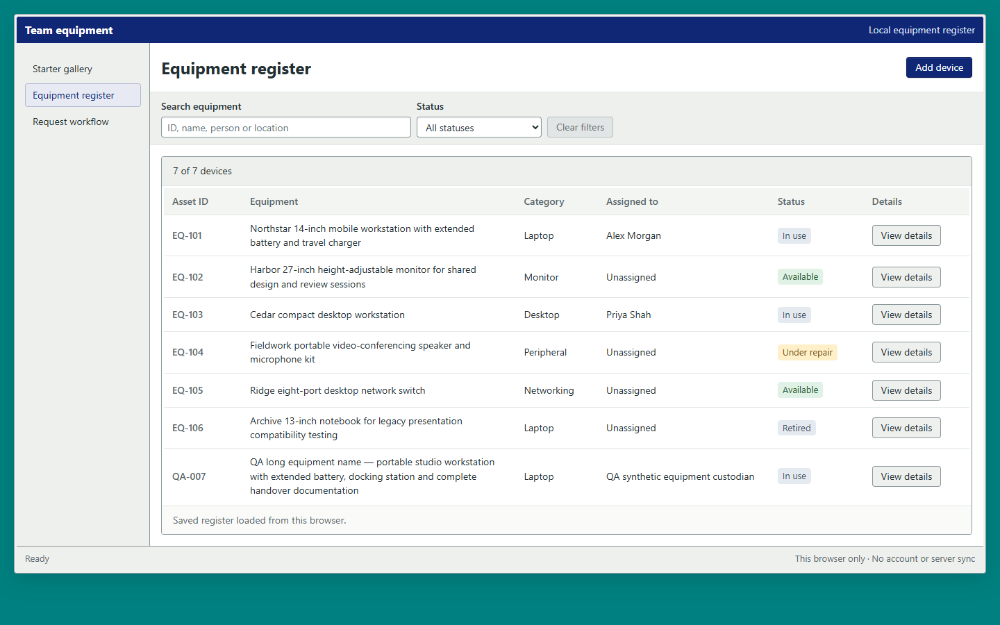

# Modern 95 UI for AI

A design skill and small UI starter for AI-assisted application development. Teal desktop, navy title bars, pale-gray chrome, precise alignment and restrained depth — a modern working interface rather than a Windows 95 replica.

[中文说明](README.zh-CN.md) · [Design rules](references/design-system.md) · [Starter API](assets/starter/USAGE.md) · [License](LICENSE)

[Live gallery](https://ai-coding-lab-au.github.io/modern-95-ui-for-ai/) · [Handover demo](https://ai-coding-lab-au.github.io/modern-95-ui-for-ai/assets/design-lab/dist/workbench.html) · [Download preview](https://github.com/ai-coding-lab-au/modern-95-ui-for-ai/releases) · [Report an issue](https://github.com/ai-coding-lab-au/modern-95-ui-for-ai/issues/new/choose)

**Public preview: 0.3.0-rc.1.** Repository: [modern-95-ui-for-ai](https://github.com/ai-coding-lab-au/modern-95-ui-for-ai). Skill invocation stays **`$modern-95-ui`**.



## What is included

- An AI-readable skill with workflow, visual rules and bounded verification.
- Scoped, framework-neutral HTML/CSS plus a small native-dialog helper.
- Three runnable Starter pages: component states, an equipment list and a service-request wizard.
- Handover desk: the preferred task-workbench reference with integrated navy caption controls.
- Original numerical tokens, MIT license, pinned Lucide sources and complete third-party notices.

This is a design skill with reference implementations, not a React component package or production backend. Use existing application components and keep business logic in the host. Fonts are developer-controlled; the provided default is Segoe UI with a sans-serif fallback. No fonts, React95, Microsoft assets or remote runtime services are bundled.

## Try in your browser

Open the [gallery](https://ai-coding-lab-au.github.io/modern-95-ui-for-ai/), [equipment list](https://ai-coding-lab-au.github.io/modern-95-ui-for-ai/assets/starter/examples/assets.html), [request wizard](https://ai-coding-lab-au.github.io/modern-95-ui-for-ai/assets/starter/examples/request.html) or [Handover desk](https://ai-coding-lab-au.github.io/modern-95-ui-for-ai/assets/design-lab/dist/workbench.html). These are the repository's existing examples, published without visual changes.

Use synthetic data only. Equipment and request records stay in browser local storage; the demo has no application backend or analytics. GitHub Pages hosts the static files. For project work, run or copy the examples locally.

## Try locally

Requires Node.js 22 or newer. No `npm install` is needed.

```sh
git clone https://github.com/ai-coding-lab-au/modern-95-ui-for-ai.git
cd modern-95-ui-for-ai
npm start
```

To try Handover instead, run `npm run start:workbench` from the repository root. Use separate terminals to run both servers together.

Windows launchers are `assets/starter/Start-Starter.cmd` and `assets/design-lab/Start-Preferred-Workbench.cmd`. If a browser is not opened automatically, open the printed loopback URL. Stop the server with Ctrl+C.

Starter uses port 55197; Handover uses 55198. The gallery and Handover keep data in memory and reset on refresh. Equipment and request examples save synthetic records in browser local storage. Records belong to the browser profile and origin, so use the same browser and URL to revisit them. A different port has a separate storage origin.



Handover's three caption buttons operate its preview area. Real desktop apps connect controls to the host window; ordinary websites omit OS-style controls unless demonstrating them explicitly.

## Use as a local Codex skill

Copy this entire repository folder, including `SKILL.md`, `references`, `assets` and licenses, to **one** of:

- Per user: `~/.agents/skills/modern-95-ui/`
- Per project: `<project>/.agents/skills/modern-95-ui/`

On Windows, the per-user folder is `%USERPROFILE%\.agents\skills\modern-95-ui`. The repository's public name and the installed folder name differ intentionally. Check for an existing installation before copying; preserve local modifications and avoid installing duplicate skills with the same name. Skill discovery and reload behavior are documented in the [official skill guide](https://developers.openai.com/codex/skills).

Example prompt:

```text
Use $modern-95-ui to refine this application's interface.
Preserve its framework, data and behavior. Start with a representative workflow,
then verify alignment, states, keyboard operation and narrow layouts.
```

For another AI tool, follow that tool's skill-loading convention and point it to `SKILL.md`; automatic discovery outside Codex has not been tested. Runtime examples and integration instructions are English; detailed design references currently use Chinese.

## Reuse in an application

Start with [USAGE](assets/starter/USAGE.md). Copy `m95.css` and optionally `m95.mjs`, together with [assets/starter/LICENSE](assets/starter/LICENSE), retaining its copyright notice and complete MIT license text in your project and redistributions. Wrap the UI in `.m95`. Add `.m95-desktop` only when a teal desktop backdrop is appropriate. Existing fonts can override `--m95-font`.



Keep routing, validation, async ownership, storage and persistence in the application. Numeric editing text stays as typed; the theme does not insert decimal places. Copying Lucide assets requires retaining their complete [license and provenance](THIRD_PARTY_NOTICES.md).

## Test and contribute

```sh
npm test
```

See [validation](docs/validation.md) for browser commands and evidence limits, [contribution rules](CONTRIBUTING.md) for lessons from other projects, and [source and license scope](docs/source-and-license.md) for this curated distribution. Historical experiments and private project evidence are outside this snapshot.

GitHub Actions checks pushes and pull requests on Node.js 22 and 24. Passing updates to `main` automatically publish the existing examples to Pages. Shared design changes and releases remain maintainer-reviewed. The [feedback form](https://github.com/ai-coding-lab-au/modern-95-ui-for-ai/issues/new/choose) accepts bugs and reusable lessons; remove private data before attaching examples.

Project code and documentation: **MIT**. Bundled Lucide geometry retains its upstream ISC and applicable Feather MIT notices. No affiliation with Microsoft is claimed.
